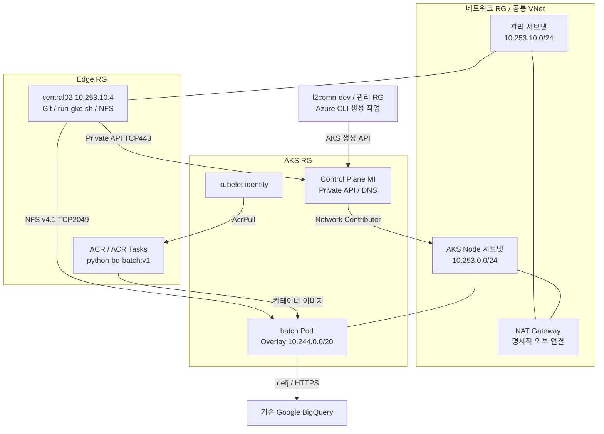

# Azure 구성 및 권한

## 구성

## 권한

| 주체 | 범위 | 역할 |
|---|---|---|
| network_admin | 네트워크 RG | Contributor |
| edge_admin | Edge RG | Contributor |
| aks_admin | AKS·생성 VM RG | Contributor |
| AKS Control Plane MI | 공통 VNet | Network Contributor |
| VM/AKS 생성 담당자 | 필요한 공통 서브넷 | Network Contributor |
| kubelet identity | ACR | AcrPull |
| edge_admin 빌드 제출자 | ACR | Container Registry Tasks Contributor + AcrPush |
| AKS 사용자 | AKS | Cluster User Role + Azure Kubernetes Service RBAC Cluster Admin |

Role assignment는 기반 권한 관리자가 별도로 수행한다. RG Contributor에 권한 부여 능력은 없다.
Service Agent 이메일을 Azure에 복사하지 않는다. Google .oefj SA는 BQ 업무 인증용으로만 유지한다.

## 네트워크·운영 차이

- Azure CNI Overlay의 /24 노드 블록은 GKE의 Pod 할당과 다르다. Pod /20으로 16노드분을 확보한다.
- AKS system 2노드와 batch 1노드로 시작, batch는 0~3 autoscaler. 별도 Pod nodeSelector를 추가하지 않아 원본과 같이 스케줄러가 배치한다.
- VM은 공인 IP 없이 기존 VPN/Bastion 관리 경로를 쓴다. 이 저장소는 Bastion/VPN을 자동 생성하지 않는다.
- Private AKS라고 모든 서비스가 사설 통신은 아니다. ACR·Google API는 기본안에서 NAT로 접근한다.
- NFS 단일 VM은 PoC 구성이다. 운영용 저장소 가용성, 백업, 키 관리, 최소 권한은 별도 설계한다.

## 공식 자료

- https://learn.microsoft.com/azure/aks/private-clusters
- https://learn.microsoft.com/azure/aks/concepts-network-azure-cni-overlay
- https://learn.microsoft.com/azure/aks/use-managed-identity
- https://learn.microsoft.com/azure/aks/manage-azure-rbac
- https://learn.microsoft.com/azure/aks/cluster-container-registry-integration
